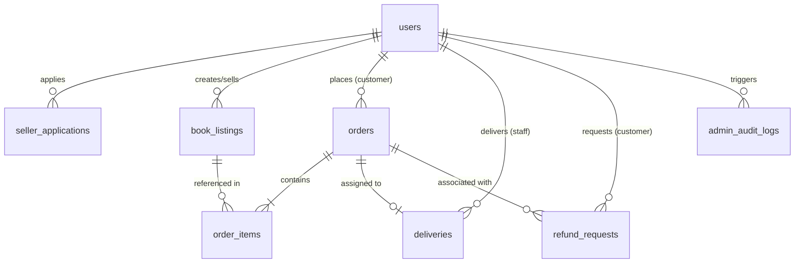
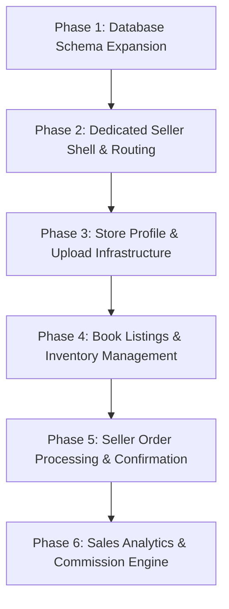

# BOOKIFY — SELLER SIDE DEVELOPMENT
## Phase 0: Existing Codebase Inspection & Architecture Audit

---

### Executive Summary

An architectural and codebase inspection of **Bookify** was conducted on the workspace (`c:\xampp\htdocs\bookify`). The application is an online book marketplace built with a **React 19 + TypeScript + Tailwind CSS v4** frontend and a **procedural PHP PDO** backend connected to a local **MySQL / MariaDB (`bookify`)** database hosted via XAMPP.

The customer/buyer interface (browsing, public book catalog, registration, email verification, login, account dashboard) and staff/admin back-office workflows (user moderation, staff creation, listing moderation, delivery dispatch, audit logging) are structurally established. However, **seller functionality is currently in an early, fragmented state**:
1. Seller application submission and staff review/approval are implemented.
2. A single listing submission endpoint exists for sellers, but it lacks reading, editing, deleting, or image uploading capabilities.
3. The seller portal on the frontend is currently embedded as a **locked preview tab** (`?tab=seller`) within the customer dashboard, rather than existing as an independent, dedicated seller workspace.

Below is the complete architectural audit across all 10 inspection criteria.

---

### 1. Current Project Folder Structure

The project root is located at `c:\xampp\htdocs\bookify`. The top-level organization separates the React/Vite client and the PHP API:

```
c:\xampp\htdocs\bookify\
├── .env                                  # Local environment config (DB credentials, App URL)
├── .env.example                          # Environment template
├── .gitignore                            # Git ignore rules
├── eslint.config.js                      # ESLint configuration
├── index.html                            # Frontend HTML entry point
├── package.json                          # Frontend dependencies & npm scripts
├── package-lock.json                     # Dependency lockfile
├── README.md                             # Comprehensive project specification
├── staffaddaccount.php                   # Legacy PHP redirect to /staffaddaccount
├── tsconfig.app.json                     # TypeScript application configuration
├── tsconfig.json                         # TypeScript root configuration
├── tsconfig.node.json                    # TypeScript node configuration
├── vite.config.ts                        # Vite configuration & Apache reverse proxy
│
├── backend/                              # PHP backend infrastructure
│   ├── .htaccess                         # Apache routing / header configuration
│   ├── config/
│   │   ├── database.php                  # PDO connection factory (getDB())
│   │   ├── env.php                       # Simple .env parser and loader
│   │   ├── mail.php                      # Mail helper (currently file-stubbed in dev)
│   │   └── session.php                   # Session configuration (SameSite, HttpOnly)
│   ├── controllers/
│   │   ├── AdminController.php           # Back-office administration (users, staff, moderation)
│   │   ├── AuthController.php            # Customer registration, login, verification, profile
│   │   ├── CatalogController.php         # Public book browsing and filtering API
│   │   ├── ListingController.php         # Seller listing creation endpoint (POST only)
│   │   ├── OperationsController.php      # Order management, delivery dispatch, refunds
│   │   ├── Phase4Controller.php          # Audit logs, notification preferences, reports
│   │   └── SellerApplicationController.php # Seller application submission and status API
│   ├── logs/
│   │   └── mail_stub.log                 # Log of outgoing verification emails
│   ├── middleware/
│   │   └── auth.php                      # Authentication, role verification, session checks
│   └── utils/
│       ├── audit.php                     # Audit logging helper (recordAdminAudit)
│       ├── csrf.php                      # CSRF token generator and validator
│       ├── response.php                  # JSON response formatters (successResponse, errorResponse)
│       └── validation.php                # Validation helpers (email, phone, password strength)
│
├── database/                             # Database schema and migration scripts
│   ├── bookify.sql                       # Base schema (users, seller_applications)
│   └── migrations/
│       ├── 2026_11_22_phase2_backoffice.sql    # book_listings, admin_audit_logs, account_status
│       ├── 2026_11_22_phase3_operations.sql    # orders, order_items, deliveries, refund_requests
│       └── 2026_11_22_phase4_accountability.sql # notification reads/preferences, delivery timestamps
│
├── public/                               # Static web assets (favicons, SVG icons)
│   ├── favicon.svg
│   └── icons.svg
│
└── src/                                  # React 19 / TypeScript source code
    ├── assets/                           # Images and SVGs (hero.png, react.svg, vite.svg)
    ├── components/                       # Shared / Landing UI components
    │   ├── Footer.tsx                    # Landing page footer
    │   ├── HeroSection.tsx               # Landing page hero
    │   ├── HowItWorks.tsx                # Process overview
    │   ├── IsometricBookshelf.tsx        # 3D interactive bookshelf (Three.js / R3F)
    │   ├── Navbar.tsx                    # Main global navigation bar
    │   ├── ProtectedRoute.tsx            # Route guard component for auth and roles
    │   ├── SellerIntroduction.tsx        # Landing page section explaining the seller program
    │   ├── ThemeToggle.tsx               # Dark/Light mode theme switch
    │   ├── TypewriterText.tsx            # Hero typography animation
    │   └── WhatIsBookify.tsx             # Marketplace concept description
    ├── contexts/
    │   └── AuthContext.tsx               # Global authentication context and provider
    ├── data/
    │   └── translations.ts               # English / Tagalog translations for landing page
    ├── hooks/
    │   ├── useIntersectionFade.ts        # Scroll-in view observer hook
    │   └── useTheme.ts                   # Theme switcher hook (dark/light tokens)
    ├── pages/
    │   ├── MarketplacePage.tsx           # Customer book catalog & book details view
    │   ├── StaffAddAccountPage.tsx       # Admin utility to provision staff accounts
    │   ├── auth/                         # Authentication & onboarding views
    │   │   ├── AccountPage.tsx           # Profile management & password update
    │   │   ├── LoginPage.tsx             # User login
    │   │   ├── RegisterPage.tsx          # Customer registration
    │   │   ├── RegisterSuccessPage.tsx   # Post-registration prompt
    │   │   ├── ResendVerificationPage.tsx# Resend email token
    │   │   ├── SellerApplicationPage.tsx # Seller program onboarding application
    │   │   └── VerifyEmailPage.tsx       # Email token verification landing
    │   ├── backoffice/                   # Staff & Administrator operational shell
    │   │   ├── BackOfficePage.tsx        # Shell layout for /admin/* and /staff/*
    │   │   ├── ManagementSections.tsx    # User, staff, seller, and listing tables
    │   │   ├── OperationsSections.tsx    # Orders, deliveries, refunds tables
    │   │   └── Phase4Sections.tsx        # Audit logs, notifications, reports
    │   └── dashboard/                    # Customer account dashboard
    │       ├── DashboardHeader.tsx       # Dashboard top bar (user profile, theme toggle)
    │       ├── DashboardPage.tsx         # Dashboard layout shell and tab router
    │       ├── DashboardSidebar.tsx      # Fixed left navigation sidebar
    │       └── tabs/
    │           ├── OrdersTab.tsx         # Customer order history (placeholder)
    │           ├── OverviewTab.tsx       # Customer overview & welcome banner
    │           ├── SellerTab.tsx         # Current locked preview of seller features
    │           ├── SettingsTab.tsx       # Customer settings & credentials
    │           └── WishlistTab.tsx       # Customer wishlist (placeholder)
    ├── services/                         # Client-side API integration services
    │   ├── adminApi.ts                   # API calls for staff/admin back-office
    │   ├── authApi.ts                    # API calls for authentication & session
    │   ├── operationsApi.ts              # API calls for back-office operations
    │   ├── phase4Api.ts                  # API calls for reports, audit, and notifications
    │   └── sellerApplicationApi.ts       # API calls for seller applications
    ├── types/
    │   └── auth.ts                       # TypeScript interfaces for auth, users, and API results
    ├── App.css                           # Component-level styles & marketplace grid styling
    ├── App.tsx                           # Main route definitions & top-level layout controller
    ├── index.css                         # Tailwind CSS v4 entry point & design tokens
    └── main.tsx                          # React DOM initialization
```

---

### 2. Existing Frontend Architecture

#### Routing Configuration
Frontend routes are managed via `react-router-dom` (v7) in `src/App.tsx`:
- **Public Routes:**
  - `/` — Landing page with 3D bookshelf (`src/components/HeroSection.tsx`).
  - `/books` & `/books/:bookId` — Marketplace catalog and book details (`src/pages/MarketplacePage.tsx`).
  - `/login`, `/register`, `/register/success`, `/verify-email`, `/resend-verification` — Authentication views.
- **Protected Back-Office Workspaces:**
  - `/admin/*` — Guarded by `allowedRoles={['admin']}` (`src/pages/backoffice/BackOfficePage.tsx`).
  - `/staff/*` — Guarded by `allowedRoles={['staff', 'admin']}` (`src/pages/backoffice/BackOfficePage.tsx`).
  - `/staffaddaccount` — Guarded by `allowedRoles={['admin']}` (`src/pages/StaffAddAccountPage.tsx`).
- **Protected Customer Dashboard:**
  - `/dashboard` — Guarded by `ProtectedRoute` (`src/pages/dashboard/DashboardPage.tsx`).
  - `/account` — Guarded by `ProtectedRoute` (`src/pages/auth/AccountPage.tsx`).
  - `/seller-application` — Guarded by `ProtectedRoute` (`src/pages/auth/SellerApplicationPage.tsx`).

> [!IMPORTANT]
> **No Dedicated Seller Route Exists:**
> There is currently no `/seller` or `/seller/*` route in `src/App.tsx`. The seller interface is currently rendered exclusively as a query-param tab (`/dashboard?tab=seller`) inside the customer dashboard.

#### Dashboard Layouts & Navigation
- **Customer Dashboard Shell:** `src/pages/dashboard/DashboardPage.tsx` renders a fixed 260px sidebar (`src/pages/dashboard/DashboardSidebar.tsx`) and a top bar (`src/pages/dashboard/DashboardHeader.tsx`).
  - Navigation between tabs (`overview`, `orders`, `wishlist`, `settings`, `seller`) is controlled via search parameters (`?tab=...`).
  - `src/pages/dashboard/DashboardSidebar.tsx` contains a "Buyer Menu" and a "Seller Hub" section. All links under "Seller Hub" (`Seller Overview`, `My Listings`, `Add a Book`, `Sales & Orders`, `Earnings`, `Seller Settings`) simply direct the user to `onSelectTab('seller')` with a "Lock" indicator.
- **Back-Office Shell:** `src/pages/backoffice/BackOfficePage.tsx` provides an independent layout for administrative operators with sub-navigation paths for users, staff, sellers, listings, orders, deliveries, and audits.

#### State Management & Authentication Flow
- Global authentication is managed by `src/contexts/AuthContext.tsx` via `useAuth()`.
- On page load, `useEffect` triggers `refreshAuth()`, executing `getMe()` in `src/services/authApi.ts` (`/backend/controllers/AuthController.php?action=me`).
- Role authorization is guarded on the client by `src/components/ProtectedRoute.tsx`, which inspects `user.role` against `allowedRoles`.

#### Styling Conventions
- **Tailwind CSS v4** (`@tailwindcss/vite`) configured in `vite.config.ts` and imported in `src/index.css`.
- **Design Tokens:** Extensive use of CSS variables defined in OKLCH color space:
  - `--bg`, `--bg-secondary`, `--surface`, `--surface-hover`, `--border`
  - `--text`, `--text-muted`, `--text-heading`
  - Brand accents: `--green-500` (`oklch(63% 0.19 155)`), `--blue-500` (`oklch(60% 0.17 240)`)
- **Typography:** Pervasive use of `'Geist Mono', monospace`.
- **Implementation Style:** A hybrid of Tailwind utility classes and explicit React inline `style={{ ... }}` blocks for layout sizing, border radii, and CSS token consumption.

---

### 3. Existing Backend Architecture

The backend consists of procedural PHP 8+ scripts running under Apache (XAMPP). It uses no monolithic framework, adhering to a lightweight controller-and-utility structure:

#### Database Connection & Query Handling
- Managed by `getDB()` in `backend/config/database.php`.
- Uses a singleton static `PDO` instance configured with:
  - `PDO::ATTR_ERRMODE => PDO::ERRMODE_EXCEPTION`
  - `PDO::ATTR_DEFAULT_FETCH_MODE => PDO::FETCH_ASSOC`
  - `PDO::ATTR_EMULATE_PREPARES => false`
- Database credentials are loaded from `.env` via `backend/config/env.php` with fallback defaults (`localhost`, `3306`, `bookify`, `root`, empty password).

#### API Response Formatting & Error Handling
- Defined in `backend/utils/response.php`:
  - `successResponse(array $data, int $statusCode = 200)`: sends `{"success": true, ...}`.
  - `errorResponse(string $message, int $statusCode = 400, array $extra = [])`: sends `{"success": false, "message": "...", ...}`.
- Every controller initializes output buffering (`ob_start()`) and sets custom exception handlers to prevent PHP HTML warnings from corrupting JSON payloads.

#### Security, Sessions & CSRF
- **Session Security:** `backend/config/session.php` configures `session.cookie_httponly = 1`, `session.use_only_cookies = 1`, `session.cookie_samesite = 'Lax'`, and 24-hour expiration.
- **CSRF Verification:** `backend/utils/csrf.php` generates a cryptographically random token stored in `$_SESSION['csrf_token']`. State-changing requests (`POST`) require this token either in the JSON body or the `X-CSRF-Token` HTTP header.
- **Role Verification:** `backend/middleware/auth.php` implements `requireDatabaseRole(PDO $db, string ...$roles)`. This function does not merely trust the session; it queries `users` table directly on every privileged request to ensure the user's role is current and `account_status == 'active'`.

#### Backend Controllers & Endpoints
| Controller | Allowed Roles | Description |
|:---|:---|:---|
| `backend/controllers/AuthController.php` | Public / Authenticated | Registration, login, logout, session verification (`action=me`), email verification, password update. |
| `backend/controllers/SellerApplicationController.php` | `customer`, `seller` | `action=current` (fetches latest application); `action=apply` (submits new application with transaction lock). |
| `backend/controllers/ListingController.php` | `seller` | Handles listing submissions (POST). Checks that `users.role == 'seller'`, `is_verified == 1`, and `seller_applications.status == 'approved'`. |
| `backend/controllers/CatalogController.php` | Public | Search, filter, and pagination for approved, published, available books from both Bookify and active sellers. |
| `backend/controllers/AdminController.php` | `admin`, `staff` | User suspension, staff provisioning, seller application approvals (`review-seller`), listing moderation (`review-listing`). |
| `backend/controllers/OperationsController.php` | `admin`, `staff` | Order tracking, delivery assignment, status updates, refund reviews. |
| `backend/controllers/Phase4Controller.php` | `admin`, `staff` | Operational reports, audit log queries, system notification preferences. |

---

### 4. Existing Database Schema and Relationships

All tables in the `bookify` database have been inspected via MariaDB schema queries.



#### Detailed Table Specifications

1. **`users`**
   - Columns: `id` (PK, INT UNSIGNED), `first_name`, `last_name`, `email` (UNIQUE), `password_hash`, `contact_number`, `role` (ENUM: `'customer'`, `'seller'`, `'staff'`, `'admin'`), `account_status` (ENUM: `'active'`, `'suspended'`), `is_verified` (TINYINT), `verification_token`, `verification_token_expires_at`, `resend_requested_at`, `verified_at`, `created_at`, `updated_at`.
   
2. **`seller_applications`**
   - Columns: `id` (PK), `user_id` (FK -> `users.id` ON DELETE CASCADE), `status` (ENUM: `'pending'`, `'approved'`, `'rejected'`), `applied_at`, `reviewed_at`, `reviewed_by` (FK -> `users.id` ON DELETE SET NULL), `notes` (TEXT).

3. **`book_listings`**
   - Columns: `id` (PK), `title`, `author`, `description`, `cover_image_path`, `category`, `price` (DECIMAL 10,2), `condition` (ENUM: `'New'`, `'Pre-owned'`), `format` (ENUM: `'Physical'`, `'E-book'`), `source` (ENUM: `'seller'`, `'bookify'`), `seller_id` (FK -> `users.id` ON DELETE SET NULL), `created_by` (FK -> `users.id` ON DELETE RESTRICT), `listing_status` (ENUM: `'pending'`, `'approved'`, `'rejected'`, `'suspended'`), `publication_status` (ENUM: `'draft'`, `'published'`, `'unpublished'`), `availability` (ENUM: `'available'`, `'unavailable'`), `moderation_reason`, `reviewed_by` (FK -> `users.id` ON DELETE SET NULL), `reviewed_at`, `created_at`, `updated_at`.

4. **`orders`**
   - Columns: `id` (PK, BIGINT UNSIGNED), `customer_id` (FK -> `users.id`), `status` (ENUM: `'pending'`, `'awaiting_seller_confirmation'`, `'confirmed'`, `'processing'`, `'ready_for_dispatch'`, `'out_for_delivery'`, `'delivered'`, `'cancelled'`), `subtotal`, `delivery_fee`, `total`, `recipient_name`, `recipient_phone`, `address_line`, `barangay`, `city`, `province`, `region`, `postal_code`, `cancellation_status`, `cancellation_reason`, `cancellation_requested_at`, `cancellation_reviewed_by` (FK -> `users.id`), `cancellation_reviewed_at`, `created_at`, `updated_at`.

5. **`order_items`**
   - Columns: `id` (PK), `order_id` (FK -> `orders.id` ON DELETE CASCADE), `book_listing_id` (FK -> `book_listings.id` ON DELETE SET NULL), `seller_id` (FK -> `users.id` ON DELETE SET NULL), `listing_source` (ENUM: `'seller'`, `'bookify'`), `title_snapshot`, `author_snapshot`, `quantity` (INT UNSIGNED), `unit_price` (DECIMAL 10,2), `created_at`.

6. **`deliveries`**
   - Columns: `id` (PK), `order_id` (UNIQUE FK -> `orders.id`), `assigned_staff_id` (FK -> `users.id`), `status` (ENUM: `'pending'`, `'assigned'`, `'picked_up'`, `'out_for_delivery'`, `'delivered'`, `'failed'`, `'cancelled'`), `notes`, `assigned_at`, `delivered_at`, `updated_at`, `created_at`.

7. **`refund_requests`**
   - Columns: `id` (PK), `order_id` (FK -> `orders.id`), `customer_id` (FK -> `users.id`), `reason`, `status` (ENUM: `'pending'`, `'approved'`, `'rejected'`), `decision_reason`, `reviewed_by` (FK -> `users.id`), `reviewed_at`, `requested_at`, `updated_at`.

8. **`admin_audit_logs`**
   - Columns: `id` (PK), `actor_id` (FK -> `users.id`), `action`, `target_type`, `target_id`, `details_json`, `created_at`.

9. **`backoffice_notification_reads`** & **`backoffice_notification_preferences`**
   - Manage operator notification timestamps and subscription preferences.

#### Schema Assessment for Seller Features
- **Inventory Stock:** `book_listings` contains an `availability` flag (`'available'` vs `'unavailable'`), but **has no numerical `stock_quantity` column**. Inventory is currently binary.
- **Store Profiles:** **No table exists** for seller store branding (e.g., store name, logo, banner, pickup address, return policy, bio).
- **Commission & Payouts:** `order_items` captures `unit_price`, but **no commission breakdown column exists** (e.g. `commission_rate`, `commission_amount`, `seller_payout_amount`). There is also no ledger/payout table.
- **Digital E-Book Storage:** `book_listings` supports `format = 'E-book'`, but **has no column or table for the downloadable file path/URL**, file size, or format specification (e.g. PDF, EPUB).

---

### 5. Existing Authentication and Authorization Workflow

1. **Account Registration:**
   - User registers via `/register` (`src/pages/auth/RegisterPage.tsx`).
   - `backend/controllers/AuthController.php` hashes the password with bcrypt (cost 12), sets `role = 'customer'`, `is_verified = 0`, generates a verification token, and logs the activation URL to `backend/logs/mail_stub.log`.
2. **Email Verification:**
   - User visits `/verify-email?token=...&email=...` (`src/pages/auth/VerifyEmailPage.tsx`).
   - `backend/controllers/AuthController.php` marks `is_verified = 1`, `verified_at = NOW()`.
3. **Session Authentication:**
   - User signs in at `/login` (`src/pages/auth/LoginPage.tsx`).
   - Credentials verified against `users.password_hash`.
   - On success, `session_regenerate_id(true)` is executed, storing user attributes in `$_SESSION`.
4. **Seller Promotion Lifecycle:**
   - A verified customer visits `/seller-application` (`src/pages/auth/SellerApplicationPage.tsx`).
   - Submits application via `backend/controllers/SellerApplicationController.php` (`action=apply`), creating a row in `seller_applications` with `status = 'pending'`.
   - Staff/Admin reviews the application in the back-office (`backend/controllers/AdminController.php` `action=review-seller`).
   - Upon approval, the backend executes an atomic transaction:
     ```sql
     UPDATE seller_applications SET status = 'approved', reviewed_at = NOW(), reviewed_by = ? WHERE id = ?;
     UPDATE users SET role = 'seller' WHERE id = ? AND role = 'customer' AND account_status = 'active';
     ```
   - On the user's next authenticated call, `requireDatabaseRole()` refreshes `$_SESSION['role'] = 'seller'`. `AuthContext` reflects `user.role === 'seller'`.

---

### 6. Current Seller-Related Implementation Status

To provide an exact status of the seller ecosystem, existing assets are categorized into three levels:

#### A. Fully Implemented & Functional
- **Seller Application Submission:** Complete UI in `src/pages/auth/SellerApplicationPage.tsx` calling `src/services/sellerApplicationApi.ts` and handled by `backend/controllers/SellerApplicationController.php`.
- **Seller Application Moderation:** Complete UI in `src/pages/backoffice/ManagementSections.tsx` (`SellerManagement`) allowing staff/admin to approve or reject applicants with audit logs.
- **Role Elevation Engine:** Automated role upgrade from `'customer'` to `'seller'` in the database upon application approval.
- **Listing Moderation Engine:** Staff/admin queue in `backend/controllers/AdminController.php` to approve, reject, or suspend seller listings.
- **Public Catalog Presentation of Seller Books:** `backend/controllers/CatalogController.php` successfully queries and displays approved seller listings where the seller is active and verified.

#### B. Partially Implemented
- **Seller Listing Creation API:** `backend/controllers/ListingController.php` exists and accepts listing creation via `POST`. However:
  - It enforces that `cover_image_path` must already exist under `uploads/books/...`, but **no image upload controller or script exists**.
  - There are **no endpoints** for a seller to view their listings (`GET`), update listings (`PUT`/`POST`), delete listings (`DELETE`), or toggle availability.
- **Seller Listings in Database:** `book_listings` supports `seller_id`, format, condition, and price, but has no stock count or digital download reference.
- **Seller Orders in Database:** `order_items` records `seller_id`, but no endpoint allows a seller to view or interact with orders containing their items.
- **Frontend Seller Tab:** `src/pages/dashboard/tabs/SellerTab.tsx` contains visual mockups of Overview, My Listings, Add a Book, Sales & Orders, Earnings, and Settings, but all controls are disabled and locked behind placeholder banners.

#### C. Completely Non-Existent
- **Dedicated Seller Dashboard Routing & Shell:** No independent `/seller/*` route or layout exists; it is currently confined inside the buyer dashboard.
- **Seller Listing Management APIs:** No backend endpoints for fetching, editing, or managing seller listings.
- **Cover Image & E-Book File Upload Endpoints:** No file upload handling in PHP.
- **Seller Order Fulfillment Workflow:** No seller-facing mechanism to confirm book availability (`awaiting_seller_confirmation` status in `orders`), view customer delivery details, or prepare items for staff dispatch.
- **Inventory Management:** No stock quantity tracking or low-stock alerts.
- **15% Commission & Financial Ledger:** No logic calculating platform commission (15%) or tracking seller payout balances.
- **Store Profiles:** No schema, backend, or UI for store names, logos, pickup addresses, or merchant settings.

---

### 7. Reusable Components and Existing Functionality

The following assets can be directly reused or leveraged when building the seller dashboard:

1. **Theme & Design Tokens:**
   - `src/index.css` provides the complete OKLCH variable design system and dark/light mode tokens.
   - `src/hooks/useTheme.ts` and `src/components/ThemeToggle.tsx` provide instant theme switching.
2. **Access Control & Routing:**
   - `src/components/ProtectedRoute.tsx` supports role filtering via `allowedRoles={['seller', 'admin']}`.
   - `src/contexts/AuthContext.tsx` exposes `user`, `refreshAuth()`, and `logout()`.
3. **Backend Middleware & Security Infrastructure:**
   - `backend/middleware/auth.php`: `requireAuth()`, `requireVerified()`, and `requireDatabaseRole($db, 'seller')`.
   - `backend/utils/csrf.php`: `validateCsrfToken()` and `getCSRFToken()`.
   - `backend/utils/response.php`: standard `successResponse()` and `errorResponse()`.
   - `backend/utils/validation.php`: sanitization and type-checking functions.
   - `backend/utils/audit.php`: `recordAdminAudit()` can log seller actions.
4. **UI Patterns from Back-Office & Marketplace:**
   - Table layouts, search bars, filter dropdowns, and pagination controls from `src/pages/backoffice/ManagementSections.tsx` and `src/pages/MarketplacePage.tsx`.
   - Stat card designs from `src/pages/backoffice/BackOfficePage.tsx`.

---

### 8. Missing Components Required for the Seller Dashboard

To fulfill the target Seller Dashboard specifications, the following components and endpoints are required:

| Target Section | Frontend Components Needed | Backend Endpoints Needed | Database Changes Needed |
|:---|:---|:---|:---|
| **Dedicated Shell** | `SellerLayout.tsx`, `SellerSidebar.tsx`, `SellerHeader.tsx` under `/seller/*` | Session & role validation (`requireDatabaseRole($db, 'seller')`) | None |
| **1. Overview** | `SellerOverviewTab.tsx` (metrics cards, quick actions, recent orders, store status) | `GET /backend/controllers/SellerDashboardController.php?action=overview` | Aggregations over `book_listings` and `order_items` |
| **2. My Books** | `SellerBooksTab.tsx` (listing table, status badges, price editor, availability toggle) | `GET /backend/controllers/SellerListingController.php?action=list`<br>`POST ...?action=toggle-availability`<br>`POST ...?action=delete` | None |
| **3. Add Book** | `SellerAddBookTab.tsx` (multi-field form, cover image uploader, e-book file uploader) | `POST /backend/controllers/SellerListingController.php?action=create`<br>`POST /backend/controllers/UploadController.php` | Add `stock_quantity`, `ebook_file_path` to `book_listings` |
| **4. Orders** | `SellerOrdersTab.tsx` (order queue, item confirmation button, buyer delivery status) | `GET /backend/controllers/SellerOrderController.php?action=list`<br>`POST ...?action=confirm-item` | Add seller confirmation tracking to `order_items` |
| **5. Inventory** | `SellerInventoryTab.tsx` (stock quantity editor, low-stock filter, out-of-stock list) | `GET /backend/controllers/SellerInventoryController.php?action=list`<br>`POST ...?action=update-stock` | Add `stock_quantity` column to `book_listings` |
| **6. Sales & Analytics** | `SellerAnalyticsTab.tsx` (revenue chart, units sold, 15% Bookify commission breakdown, net earnings) | `GET /backend/controllers/SellerAnalyticsController.php?action=summary` | Add `commission_fee`, `seller_net_amount` snapshots to `order_items` |
| **7. Store Profile** | `SellerStoreProfileTab.tsx` (store name, bio, logo/banner upload, pickup address) | `GET /backend/controllers/SellerStoreController.php?action=get`<br>`POST ...?action=update` | Create `seller_profiles` table |
| **8. Settings** | `SellerSettingsTab.tsx` (notification preferences, payout bank details) | `GET /backend/controllers/SellerSettingsController.php?action=get`<br>`POST ...?action=update` | Create `seller_payout_methods` table |

---

### 9. Potential Architectural Problems or Integration Risks

1. **Dashboard Embedding vs. Dedicated Workspace:**
   - *Risk:* Currently, the seller interface is embedded in `src/pages/dashboard/DashboardPage.tsx` under a tab. Forcing 8 extensive seller sub-modules into a buyer dashboard tab degrades UX, causes URL routing limitations, and couples customer and seller concerns.
   - *Mitigation:* Decouple the seller portal into a dedicated route prefix `/seller/*` using a dedicated layout component, mirroring the architecture used by `/admin/*` and `/staff/*`.
2. **Multi-Seller Order Handling:**
   - *Risk:* An order placed by a customer may contain book listings from multiple independent sellers. The `orders` table has an overall status (`awaiting_seller_confirmation`), but if Seller A confirms while Seller B has not, the overall order state blocks.
   - *Mitigation:* Ensure seller confirmation and availability tracking operate at the `order_items` level rather than mutating the root `orders.status` directly.
3. **Commission Calculation Integrity:**
   - *Risk:* Bookify requires a 15% platform commission. If calculated on the fly from current book prices, retroactive price adjustments will corrupt past financial analytics.
   - *Mitigation:* Persist `unit_price`, `commission_amount` (15%), and `seller_net_amount` (85%) as immutable snapshot columns in `order_items` at the exact time an order is placed.
4. **Physical vs. Digital (E-Book) Fulfillment Divergence:**
   - *Risk:* Physical books require warehouse/staff pickup and dispatch in the Philippines via the `deliveries` table. E-books do not require deliveries, staff assignment, or delivery fees.
   - *Mitigation:* When an order contains digital items, the operational workflow must bypass courier dispatch and provide an authorized download link to the customer upon payment confirmation.
5. **File Upload Security:**
   - *Risk:* Book covers and digital e-book files require multipart file uploads. Without proper validation, upload endpoints can introduce arbitrary script execution risks.
   - *Mitigation:* Implement strict MIME-type sniffing, extension whitelisting (JPEG, PNG, WebP for covers; PDF, EPUB for digital books), file size limits, and store uploaded files outside public executable paths.
6. **Role Elevation Session Staleness:**
   - *Risk:* When an admin approves a seller application, `users.role` in MariaDB updates to `'seller'`, but the user's active browser session may still reflect `'customer'` until a reload or API call invokes `requireDatabaseRole()`.
   - *Mitigation:* Implement automatic session role synchronization or an explicit token refresh call upon loading the application page.

---

### 10. Recommended Implementation Sequence

To construct the seller-side ecosystem safely without breaking existing customer or back-office features, the following phased sequence is recommended:



#### Step 1: Database Migration
- Create `database/migrations/2026_11_23_phase5_seller_ecosystem.sql`:
  - Alter `book_listings`: add `stock_quantity` (INT, default 1), `ebook_file_path` (VARCHAR 500, nullable).
  - Alter `order_items`: add `fulfillment_status` (ENUM: `'pending'`, `'confirmed'`, `'declined'`, `'dispatched'`), `commission_amount` (DECIMAL 10,2), `seller_net_amount` (DECIMAL 10,2).
  - Create `seller_profiles`: `user_id` (PK), `store_name`, `bio`, `logo_path`, `banner_path`, `pickup_address_line`, `pickup_barangay`, `pickup_city`, `pickup_province`, `pickup_contact`.
  - Create `seller_payout_settings`: `user_id` (PK), `bank_name`, `account_name`, `account_number`, `payout_channel`.

#### Step 2: Dedicated Seller Shell & Routing Setup
- Create `/seller/*` routes in `src/App.tsx` wrapped in `<ProtectedRoute allowedRoles={['seller', 'admin']}>`.
- Build `src/pages/seller/SellerLayout.tsx`, `SellerSidebar.tsx`, and `SellerHeader.tsx` implementing the 8 designated navigation targets.

#### Step 3: Secure Upload & Store Profile Infrastructure
- Create `backend/controllers/UploadController.php` for secure cover image and digital e-book file processing.
- Create `backend/controllers/SellerStoreController.php` and corresponding `src/pages/seller/tabs/StoreProfileTab.tsx` and `SettingsTab.tsx`.

#### Step 4: Book Listings & Inventory Management (CRUD)
- Build `backend/controllers/SellerListingController.php` providing `list`, `get`, `create`, `update`, `delete`, and `toggle-availability`.
- Build `My Books`, `Add Book`, and `Inventory Management` frontend modules.

#### Step 5: Seller Order Processing & Confirmation Workflow
- Build `backend/controllers/SellerOrderController.php` to fetch orders containing the authenticated seller's books.
- Implement the "Confirm Availability" action so sellers can verify item stock before staff dispatching begins.
- Build the `Orders` seller view.

#### Step 6: Sales Analytics & 15% Platform Commission Engine
- Build `backend/controllers/SellerAnalyticsController.php` calculating gross book sales, the platform's 15% fee, net earnings, and historical orders.
- Build `Overview` and `Sales & Analytics` tabs with metric summaries and charts.

---

### Verification Note
This report is based entirely on direct inspection of the repository files and live MariaDB schema queries. No code, configuration, or database structures were altered during this audit. The project is fully primed for seller-side development upon approval.
