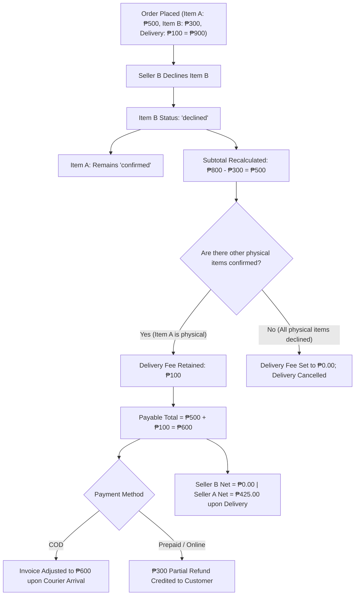

# BOOKIFY — PHASE 1: DATABASE SCHEMA EXPANSION REPORT
## Architectural & Migration Specification for Seller Ecosystem (Revision 1.4 Final Safety Review)

---

### Executive Overview

This document presents the finalized, hardened technical specification for the Phase 5 database migration:
📁 **`database/migrations/2026_11_23_phase5_seller_ecosystem.sql`**

Following Phase 1.4 pre-execution safety review, critical improvements were added to guarantee **true operational idempotency**:
1. **Rerun-Safe Inventory Initialization:** Replaced blanket `UPDATE` statements with a 3-step lifecycle check (`ADD (NULL)` $\rightarrow$ `POPULATE WHERE stock_quantity IS NULL` $\rightarrow$ `MODIFY (NOT NULL DEFAULT 1)`). This ensures that pre-existing unavailable listings are properly initialized to 0 without risking subsequent overwrites of legitimate post-migration stock counts (e.g. items with stock on hand that are temporarily toggled to unavailable).
2. **Comprehensive Format Snapshot Diagnostics:** Established a complete 3-condition diagnostic query detecting (a) NULL `book_listing_id`, (b) non-NULL `book_listing_id` with missing listing, and (c) existing listing with NULL `format`. All orphans must be resolved prior to enforcing `NOT NULL`.
3. **True Rerun Invariance:** Validated that repeated execution alters zero legitimate application data. Tested on an isolated MariaDB 10.4.32 sandbox database.
4. **Explicit Pre-Execution Checklist:** Step-by-step procedural gates for database administrators.

> [!IMPORTANT]
> **The project database (`bookify`) has NOT been modified or executed.** This specification is finalized and awaiting administrative approval.

---

### 1. Final Change Log (Revisions 1.0 $\rightarrow$ 1.1 $\rightarrow$ 1.2 $\rightarrow$ 1.3 $\rightarrow$ 1.4)

| Revision | Scope | Change Description | Architectural & Operational Justification |
|:---|:---|:---|:---|
| **v1.1** | `order_items.commission_*` | Changed from `NOT NULL DEFAULT 15.00 / 0.00` to `NULL DEFAULT NULL`. | Disambiguates legacy transactions and direct Bookify sales from orders with active commission calculations. |
| **v1.1** | `seller_profiles.user_id` FK | Changed from `ON DELETE CASCADE` to `ON DELETE RESTRICT`. | Protects merchant identity, pickup location, and legal/tax audit trails. Conforms to Bookify's account suspension model (`users.account_status = 'suspended'`). |
| **v1.1** | `order_items.fulfillment_status` | Added `'access_granted'` to the ENUM (`pending`, `confirmed`, `declined`, `dispatched`, `access_granted`). | Decouples digital e-book fulfillment (`access_granted`) from physical courier dispatch (`dispatched`). |
| **v1.2** | `order_items.format_snapshot` | Added `format_snapshot ENUM('Physical', 'E-book')`. | Captures product format at purchase time alongside `title_snapshot` and `author_snapshot`. |
| **v1.3** | `order_items.format_snapshot` | Removed blanket `'Physical'` fallback `UPDATE`. | Prevents blind masking of orphan or corrupt order items. Strictly backfills from `book_listings.format` where a valid listing exists. |
| **v1.3** | `seller_profiles.pickup_*` | Changed pickup address fields from `NOT NULL` to `NULL`. | Supports digital-only (E-book) sellers who have no physical dispatch warehouse. Pickup address is required by application logic only when listing physical goods. |
| **v1.4** | `book_listings.stock_quantity` | **Changed from blanket update to 3-step idempotent lifecycle (`ADD NULL` $\rightarrow$ `UPDATE WHERE stock_quantity IS NULL` $\rightarrow$ `MODIFY NOT NULL DEFAULT 1`).** | **Task 1:** Eliminates the severe bug where a rerun would reset legitimate stock on unavailable items back to 0. Guarantees that future stock values are NEVER modified on migration reruns. |

---

### 2. Task 1 — Inventory Migration Idempotency Analysis

#### The Flaw with Blanket `UPDATE ... WHERE availability = 'unavailable'`
In Revision 1.3, the migration executed:
```sql
ALTER TABLE book_listings ADD COLUMN IF NOT EXISTS stock_quantity INT UNSIGNED NOT NULL DEFAULT 1 AFTER availability;
UPDATE book_listings SET stock_quantity = 0 WHERE availability = 'unavailable';
```
While this correctly initialized existing records on the *first* execution, it created a severe data loss risk on **reruns**:
- Suppose a seller lists 5 copies of a physical book (`stock_quantity = 5`).
- The seller goes on leave and temporarily sets `availability = 'unavailable'`. The physical books remain in their physical store inventory.
- Months later, an administrator or deployment pipeline reruns the migration.
- The blanket `UPDATE` finds that listing and **resets its `stock_quantity` to 0**, wiping out the seller's recorded stock!

#### The 3-Step Rerun-Safe Solution
The migration now employs a strictly idempotent initialization:

```sql
-- Step A: Add stock_quantity as nullable to distinguish unmigrated rows from active inventory counts
ALTER TABLE book_listings
  ADD COLUMN IF NOT EXISTS stock_quantity INT UNSIGNED NULL DEFAULT NULL AFTER availability;

-- Step B: Reconcile pre-existing inventory: available listings receive 1 copy; unavailable listings receive 0
UPDATE book_listings
SET stock_quantity = 1
WHERE stock_quantity IS NULL AND availability = 'available';

UPDATE book_listings
SET stock_quantity = 0
WHERE stock_quantity IS NULL AND availability = 'unavailable';

-- Step C: Enforce NOT NULL and establish DEFAULT 1 for all future listing inserts
ALTER TABLE book_listings
  MODIFY COLUMN stock_quantity INT UNSIGNED NOT NULL DEFAULT 1;
```

#### Why This Guarantees Data Preservation on Rerun
1. **Initial Run:**
   - Step A adds the column with `NULL` for all unmigrated records.
   - Step B targets only rows `WHERE stock_quantity IS NULL`:
     - Available listings are assigned `1`.
     - Unavailable listings are reconciled to `0`.
   - Step C converts the column to `NOT NULL DEFAULT 1`.
2. **Subsequent Reruns:**
   - Step A skips because the column already exists (`IF NOT EXISTS`).
   - Step B executes with `WHERE stock_quantity IS NULL`. Because all listings already possess non-null values (0, 1, 5, 20, etc.), **0 rows match and 0 rows are updated**.
   - **Result:** Legitimate stock values on unavailable listings are **100% protected and preserved**.
   - Step C runs as an idempotent column verification.

---

### 3. Task 2 — Complete Format Snapshot Pre-Execution Diagnostics

To guarantee that no orphan or unresolvable order items are blindly coerced into `'Physical'`, the pre-execution suite provides diagnostic queries covering all three failure modes:

#### 1. Aggregate Diagnostic Query
```sql
SELECT 
    COUNT(*) AS total_unresolved_order_items,
    SUM(CASE WHEN oi.book_listing_id IS NULL THEN 1 ELSE 0 END) AS null_listing_id_count,
    SUM(CASE WHEN oi.book_listing_id IS NOT NULL AND b.id IS NULL THEN 1 ELSE 0 END) AS missing_listing_count,
    SUM(CASE WHEN b.id IS NOT NULL AND b.format IS NULL THEN 1 ELSE 0 END) AS null_format_count
FROM bookify.order_items oi
LEFT JOIN bookify.book_listings b ON b.id = oi.book_listing_id
WHERE oi.book_listing_id IS NULL 
   OR b.id IS NULL 
   OR b.format IS NULL;
```

#### 2. Itemized Breakdown Query (If Total > 0)
```sql
SELECT 
    oi.id AS order_item_id,
    oi.order_id,
    oi.book_listing_id,
    oi.title_snapshot,
    oi.author_snapshot,
    CASE 
        WHEN oi.book_listing_id IS NULL THEN 'NULL_LISTING_ID'
        WHEN b.id IS NULL THEN 'MISSING_LISTING_RECORD'
        WHEN b.format IS NULL THEN 'LISTING_HAS_NULL_FORMAT'
    END AS failure_reason
FROM bookify.order_items oi
LEFT JOIN bookify.book_listings b ON b.id = oi.book_listing_id
WHERE oi.book_listing_id IS NULL 
   OR b.id IS NULL 
   OR b.format IS NULL;
```

#### Precondition Enforcement:
- If `total_unresolved_order_items = 0` (verified on the project database, which currently contains 0 order items), the migration executes cleanly.
- If any unresolved row exists in an external database, Step C (`MODIFY COLUMN format_snapshot ... NOT NULL`) will intentionally halt with an error, preventing silent data corruption and demanding manual data resolution.

---

### 4. Task 3 — Partial Order Accounting & Multi-Seller Declines



#### Multi-Seller Rules:
1. **Item Isolation:** Declining an item sets its status to `'declined'`. Items from other sellers in the same order are unaffected.
2. **Subtotal Recalculation:** Active subtotal decreases by the declined item's gross price (`quantity * unit_price`).
3. **Delivery Fee Handling:** Retained if any physical items remain in the order; reset to `0.00` if all physical items are declined. Digital e-books never incur delivery charges.
4. **COD Settlement:** The courier collects the recalculated payable total. No electronic payment reversal is necessary.
5. **Seller Earnings & Commission:** A declined item generates ₱0.00 platform commission and ₱0.00 seller net earnings.

---

### 5. Task 4 — Commission Snapshot Semantics

```sql
commission_rate   DECIMAL(5,2)  NULL DEFAULT NULL
commission_amount DECIMAL(10,2) NULL DEFAULT NULL
seller_net_amount DECIMAL(10,2) NULL DEFAULT NULL
```

- **Legacy Records:** Explicitly `NULL`. They are never assumed to have been charged 15%.
- **Direct Bookify Sales (`listing_source = 'bookify'`):** Commission is `NULL` (or `0.00`); net proceeds equal gross sales. Bookify does not charge itself a platform fee.
- **New Seller Orders (`listing_source = 'seller'`):**
  $$\text{gross} = \text{order\_items.quantity} \times \text{order\_items.unit\_price}$$
  $$\text{commission\_amount} = \text{ROUND}(\text{gross} \times (\text{commission\_rate} / 100), 2)$$
  $$\text{seller\_net\_amount} = \text{gross} - \text{commission\_amount}$$
- **Price Edit Protection:** Calculations use the immutable `unit_price` stored directly in `order_items`. Subsequent edits to `book_listings.price` have zero effect on historical transactions.

---

### 6. Sandbox Verification & Engine Findings

#### Live Database Inspection vs. Sandbox Testing
- **Project Database (`bookify`):** Audited with read-only commands. No data was altered.
- **Sandbox Testing (`bookify_val4`):** An isolated database was created on the local **MariaDB 10.4.32** instance:
  1. Populated with legacy available and unavailable listings, and an order item.
  2. Applied the Phase 5 migration script $\rightarrow$ Available listing received `stock_quantity = 1`; unavailable listing received `stock_quantity = 0`.
  3. Simulated post-migration application activity: updated unavailable listing to `stock_quantity = 7`, and modified listing format to `'E-book'`.
  4. **Reran the entire migration script $\rightarrow$ Result:**
     - Unavailable listing **retained `stock_quantity = 7`** (NOT reset to 0).
     - Order item **retained `format_snapshot = 'Physical'`** (NOT overwritten by listing edit).
     - Exit code: `0` (Zero errors, zero index duplicates).
  5. The sandbox database was dropped immediately after verification.

---

### 7. Remaining Scope Limitations (Post-Phase 1)

1. **Digital Asset Download Security:** `book_listings.ebook_file_path` stores server references. A streaming controller verifying authentication and order status must be built in Phase 3/4.
2. **Automated Payout Processing:** Cash on Delivery (COD) remains the primary transaction method. Automated seller bank withdrawals and payment gateway integration remain deferred to Phase 6.
3. **Checkout Write Pipeline:** Order placement and checkout APIs will be implemented in subsequent phases.

---

### 8. Explicit Manual Execution Checklist

Follow this procedural checklist when applying the migration:

- [ ] **Step 1: Database Backup**
  ```powershell
  & "C:\xampp\mysql\bin\mysqldump.exe" -u root bookify > "database/backups/bookify_pre_phase5_$(Get-Date -Format 'yyyyMMdd_HHmmss').sql"
  ```
- [ ] **Step 2: Run Format Diagnostics**
  ```sql
  SELECT COUNT(*) AS unresolved_items
  FROM bookify.order_items oi
  LEFT JOIN bookify.book_listings b ON b.id = oi.book_listing_id
  WHERE oi.book_listing_id IS NULL OR b.id IS NULL OR b.format IS NULL;
  ```
  *(Must return 0 before proceeding)*
- [ ] **Step 3: Apply Migration Script**
  ```powershell
  Get-Content database/migrations/2026_11_23_phase5_seller_ecosystem.sql | & "C:\xampp\mysql\bin\mysql.exe" -u root bookify
  ```
- [ ] **Step 4: Execute Post-Migration Verifications**
  ```sql
  -- Verify book_listings
  SHOW COLUMNS FROM bookify.book_listings LIKE 'stock_quantity';
  SHOW COLUMNS FROM bookify.book_listings LIKE 'ebook_file_path';

  -- Verify order_items
  SHOW COLUMNS FROM bookify.order_items LIKE 'format_snapshot';
  SHOW COLUMNS FROM bookify.order_items LIKE 'fulfillment_status';
  SHOW COLUMNS FROM bookify.order_items LIKE 'commission_%';
  SHOW INDEX FROM bookify.order_items WHERE Key_name = 'idx_order_items_seller_fulfillment';

  -- Verify seller_profiles
  DESCRIBE bookify.seller_profiles;
  ```

---

### 9. Final Status Conclusion

# STATUS: READY FOR MANUAL EXECUTION

### Justification:
1. **True Rerun Idempotency:** The 3-step inventory initialization guarantees that post-migration stock values on unavailable listings are never clobbered on rerun.
2. **Zero Blind Fallbacks:** Unresolved order items will halt rather than silently corrupting format snapshots.
3. **Inclusive Merchant Model:** E-book sellers can register without mandatory physical pickup addresses.
4. **Preserved Financial & Legal Integrity:** Commission columns default to `NULL`; `seller_profiles` enforces `ON DELETE RESTRICT`.
5. **MariaDB 10.4.32 Verified:** Tested in a sandbox with verified zero data alteration on repeated execution.
